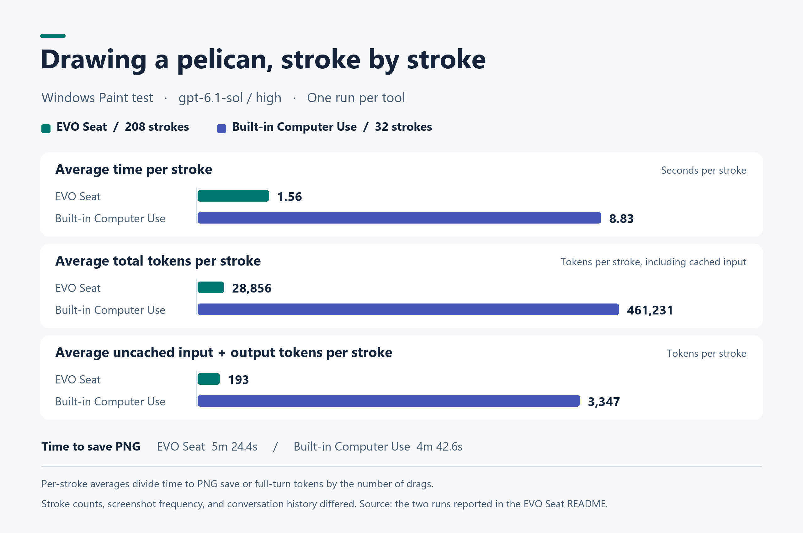

# EVO Seat

[简体中文](README.md) · [Install for Codex](docs/codex.md) · [Agent workflow](AGENTS.md) · [Latest release](https://github.com/binaryaoucstics-lang/evo-seat/releases/latest)

EVO Seat gives Codex a hidden Windows desktop for operating and testing real GUI apps. An agent can launch an app, inspect its accessibility tree, send mouse and keyboard input, capture screenshots, and verify changes without taking over your foreground desktop.

- **Observe and act.** Use window IDs, accessibility snapshots, or seat-relative pixels. Pass `observeAfter: true` to `seat_element` to get a fresh snapshot after an intermediate action.
- **Share the seat.** Codex starts with two regions. The third task expands the layout to four regions, and the fifth expands it to twelve. Running tasks keep their windows and region positions. Use an exclusive lease for operations that need the full desktop. The seat shares the Windows account and files.
- **Capture evidence.** Request a full-resolution PNG for small text or combine accessibility data and a screenshot when verifying a receipt.
- **Watch live.** A read-only monitor opens when a background task takes a new desktop lease. The exclusive desktop defaults to 1440 × 900. The window follows layout changes as they happen. The picture stays at native pixel size when it fits and scales down to the current display's work area when needed. Hiding the monitor leaves the task running. Reopen it from the system tray.
- **Region borders and mouse control.** Each region has a number and a border. In-use regions have brighter borders. Click **接管鼠标** (Take control) to use your mouse and keyboard on the background desktop. The borders turn teal while you have control. Click **归还控制** (Release control) or hide the monitor to return to read-only viewing.

For installation, give your Codex agent the [installation guide](docs/codex.md). For operation, give it the [agent workflow](AGENTS.md).

To start a new seat with automatic monitoring disabled, use `--no-monitor` as shown in the [Codex installation guide](docs/codex.md#4-watch-background-tasks).

## Windows Paint comparison

Both runs used **`gpt-6.1-sol` with `high` reasoning effort**. Each started with a blank Windows Paint canvas and saved a 1000 × 410 PNG. EVO Seat used a hidden desktop. Built-in Computer Use used the foreground Paint window.

| Measured in Codex | EVO Seat | Built-in Computer Use |
| --- | ---: | ---: |
| Time from turn start to PNG save | 5m 24.4s | 4m 42.6s |
| Full turn, through the final reply | 5m 36.3s | 5m 03.8s |
| Total tokens, including cached input | 6,002,040 | 14,759,395 |
| Cached input tokens | 5,961,856 | 14,652,288 |
| Uncached input tokens | 33,205 | 102,239 |
| Output tokens, including reasoning | 6,979 | 4,868 |
| Tool calls issued by Codex | 44 | 62 |
| Desktop API calls | 306 | 114 |
| Drag strokes | 208 | 32 |
| Average time per stroke (through PNG save) | 1.56 s | 8.83 s |
| Average total tokens per stroke (including cached input) | 28,856 | 461,231 |
| Average uncached input plus output tokens per stroke | 193 | 3,347 |



Times use the Codex turn log and PNG write timestamps. Token counts sum all model requests in each turn, including the conversation history sent with those requests. Codex tool calls include orchestration, such as waiting for an ongoing batch. Desktop API calls count individual `seat_*` MCP calls for EVO Seat and `sky` API calls for built-in Computer Use, including calls inside scripts. The per-stroke figures divide time through PNG save and full-turn token counts by the number of drags, so setup, screenshots, and other work are spread across the strokes.

Built-in Computer Use saved its PNG 41.8 seconds sooner and used about 2.46× as many total tokens. The EVO Seat run batched more short strokes, while the built-in run refreshed the window after each action and started with more conversation history. These are two observed runs with different stroke counts and context sizes, so the table describes those workflows.

**EVO Seat**


**Built-in Computer Use**


## Build from source

Use Windows x64, the .NET 10 SDK, and Node.js 22.19 or later. From the repository root:

```powershell
npm ci --ignore-scripts
dotnet publish .\src\Anode\Anode.csproj -c Release -r win-x64 --self-contained true -p:PublishSingleFile=false -o native
Copy-Item .\native\anode.exe .\native\evo-seat.exe
& .\native\evo-seat.exe selftest --quick | Out-Host
```

Then follow the setup and registration steps in the [Codex guide](docs/codex.md).

## License

[MIT](LICENSE). EVO Seat is based on [Anode](https://github.com/skulitom/Anode/tree/1ad6eae42c023654fd8de463a9d7a6e9ff787e1a) and incorporates some window containment work from BgDesk. See [third-party notices](THIRD-PARTY-NOTICES.md).
